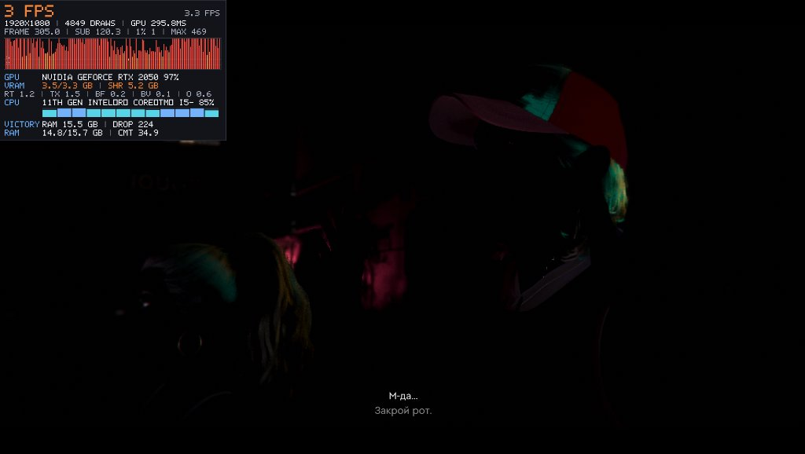
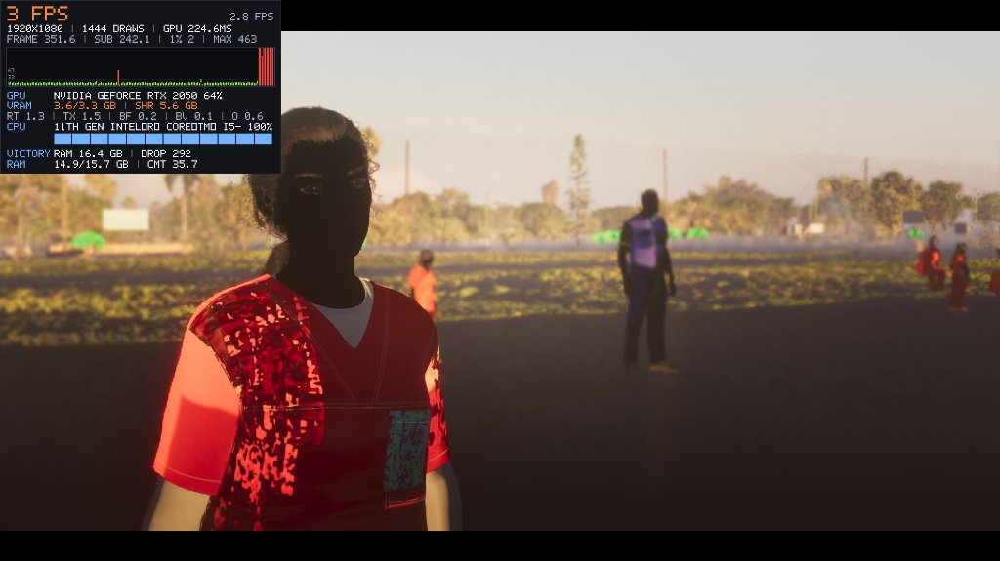
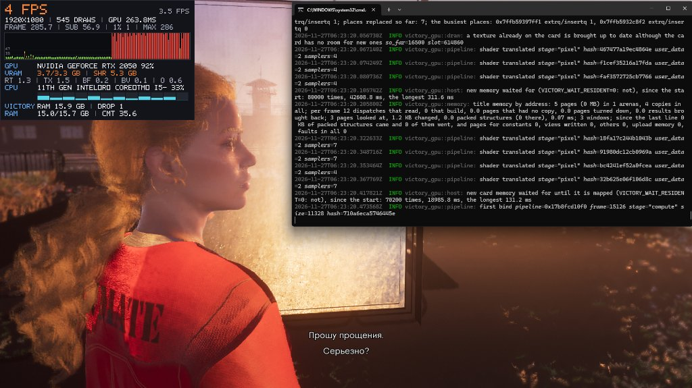

# VIctory — Low-VRAM Laptop Fork (RTX 2050 4 GB / 16 GB RAM)

A fork of [VIctory](https://github.com/Marvisak/VIctory), a compatibility layer
that runs Grand Theft Auto VI (Xbox Series X|S, retail 1.0.2.1) natively on
Windows from files the user supplies.

This branch focuses on **getting the world (`Americas`) to boot, render, and
progress toward playable frame rates on budget 4 GB VRAM / 16 GB RAM laptops**
with NVIDIA GPUs.

## Test Hardware & Current Status (2026-11-27)

Tested on:

| Component | Spec |
|---|---|
| OS | Windows 11 x64 |
| GPU | NVIDIA GeForce RTX 2050 Laptop GPU (`4 GB` VRAM, `3.3 GB` DXGI local budget) |
| CPU | Intel Core i5-11400H (11th Gen, 6C/12T @ 2.70 GHz) |
| RAM | `16 GB` (`15.7 GB` usable) + Windows pagefile (`35+ GB` commit during world play) |
| Game Profile | `--console series-s` (`1920x1080`, ray tracing off, `VICTORY_AMBIENT=0.8`) |

| Milestone | Status |
|---|---|
| Boot & loading slides | Works (press **Enter** / **A** at the `PLAYER (A)` profile screen so `core_restofworld001.rpf` opens) |
| Time to world (`Americas`) | `~3m 15s` with warm shader & pipeline cache |
| World gameplay / cutscenes | Renders (`545–4,849` draws/frame), **`3–4 FPS`** (`225–352 ms/frame`, GPU `225–296 ms`) |
| VRAM / Shared / RAM | `3.5–3.7 / 3.3 GB` VRAM, `5.2–5.6 GB` shared, `14.8–15.0 / 15.7 GB` RAM, `34.9–35.7 GB` commit |

## Progress Screenshots (RTX 2050 Laptop, 1920x1080)

> Early WIP screenshots (`3–4 FPS`): world geometry, lighting, and characters load
> cleanly in `Americas`, while low-VRAM texture caps currently cause dark skin
> and downscaled/missing textures in heavier outdoor scenes.

| Intro car cutscene (`3 FPS`, `4849 draws`, `GPU 295.8 ms`) | Prison yard (`3 FPS`, `1444 draws`, `GPU 224.6 ms`) |
|---|---|
|  |  |

| Indoors cutscene (`4 FPS`, `545 draws`, `GPU 263.8 ms`, live logs) |
|---|
|  |

## Known Issues on 4 GB VRAM / 16 GB RAM (Active Work in Progress)

- **Dark characters / low-res textures**: Under a `3.3 GB` DXGI VRAM budget,
  conservative texture headroom limits (`no room for new ones`) and aggressive
  mip caps (`256/512`) starve character skin and world surface textures in
  outdoor scenes (`1,400+` draws).
- **Residency wait stalls**: Aggressive `16 GB` memory-pressure thresholds trigger
  frequent pool trimming, causing tens of thousands of synchronous `MakeResident`
  and copy-queue mapping waits (`resident()` / `mapped()`).
- **Commit / shared-memory spill**: When `3.3 GB` local VRAM fills, `5+ GB` spills
  into shared system memory (`CMT ~35 GB`), requiring a large Windows pagefile.

## Running on Low-VRAM / 16 GB Laptops

```powershell
copy victory.example.toml victory.toml   # set game_dir, cache_dir, data_dir outside the repo
cargo build --release -p victory
```

Run from the repository folder (or any folder where `victory.toml` can be found by walking up from `victory.exe`):

```powershell
target\release\victory.exe run --execute --console series-s <game_dir>\game_scarlett_master.exe
```

Notes:
- `--console series-s` targets `1080p` and fits a 4 GB VRAM card much better than Series X `4K`.
- At the **`PLAYER (A)`** Xbox profile screen (~`35–50s` after launch), press **Enter** (keyboard fallback for `A`) or **A** on your controller so loading continues into `core_restofworld001.rpf`.
- Fullscreen mode and performance switches (`VICTORY_PORT_CONSTANTS=1`, `VICTORY_PORT_DESCRIPTORS=1`, `VICTORY_PORT_CBV=1`, `VICTORY_PORT_GUARD=1`, `VICTORY_PORT_JOURNAL=1`, `VICTORY_THIN=1`, `VICTORY_CARD_STEPS=2`, etc.) are applied automatically by `victory run --execute` unless `--safe` or `--windowed` is passed.

On a hybrid-graphics PC, the runtime and offline pipeline checks prefer a
high-performance adapter with Shader Model 6.6. The runtime logs its adapter
name, PCI vendor and device IDs, and dedicated VRAM. Set
`VICTORY_D3D12_ADAPTER` to a zero-based DXGI index or part of the adapter's
name to select it explicitly. With the launcher, pass
`-More @{VICTORY_D3D12_ADAPTER='NVIDIA'}`.

Before the first run, ahead of time (both can be stopped and go on later):

```powershell
target\diag\victory.exe shaders <the shader archives>   # every shader translated, minutes
target\diag\victory.exe warm --used                     # pipelines earlier runs drew with, for a new driver or build
```

Commands, debugging switches and upstream's own description:
[docs/README-fxceless.md](docs/README-fxceless.md). Every `VICTORY_...` switch is
described in a comment where it is read.

## What is different here

In short; the reasons and the measurements are in [docs/findings.md](docs/findings.md).

- **List calls are written down, not carried out, on the title's threads**
  (`VICTORY_THIN`): eight threads of ours translate them.
- **Submissions are prepared by a thread of ours and joined**
  (`VICTORY_ASYNC_SUBMIT`, `VICTORY_JOIN_PARTS`), with what can be spread over
  threads spread: refreshes, compares (AVX2), descriptor records, landings.
- **What shaders wrote comes back beside the write guards**, by the dwords that
  changed, on a thread of its own (`VICTORY_RELAY`, `VICTORY_LAND`).
- **Buffer fills that need bytes still on the card are done on the card**
  (`VICTORY_CARD_STEPS`) instead of waiting for it.
- **The title's writes are caught more cheaply**: one view opened at a fault,
  blocks that rest, places in the title's code that look before they write.
- **Textures go up on a copy queue of their own** and a slot shows one only after
  its upload ran, which also ended a device loss that came every 15 minutes or so.
- **Boats float**: textures that shaders write and the title's CPU reads go back
  to title memory (from fxceless and Geckomacabre, on by default here).
- **Frame record and replay** with per-pass times and shader variants compared
  turn by turn ([docs/replay.md](docs/replay.md)).

## Credits

This is a tree of other people's work with more on top. The history is kept, and
commits taken from elsewhere name the commit and its author.

- **[VIctory](https://github.com/Marvisak/VIctory)** by Marvisak and its
  contributors: the loader, the runtime services, the Direct3D 12 back end and
  the shader recompiler.
- **[fxceless/victory-fork](https://github.com/fxceless/victory-fork)**: the fork
  this one started from, and the people whose pull requests it carries.
- **[DexNom/VIctory](https://github.com/DexNom/VIctory)**: ray tracing fixes,
  cube gradients, sparse textures.
- **[Belobug/VIctory-Belobug-AMD](https://github.com/Belobug/VIctory-Belobug-AMD)**:
  the ambient light idea, pipeline workers, and work by romainhedouin.
- **[FQY55kai/ZJOU-VICTORY](https://github.com/FQY55kai/ZJOU-VICTORY)**.
- **[myokex/victory-amd](https://github.com/myokex/victory-amd)**: the guard over
  every view of a page (with Spexivus, joroyt and tightfall), and Joshua Odom's
  reads into title memory.
- **Geckomacabre** and **cxy0072019-sketch**: the texture read-back.
- **[XCL](https://github.com/ivall/xcl)** (GPL-2.0-only) was read for how the same
  title behaves under another layer; no code of it is here.
- This fork's changes were made with [Claude Code](https://claude.com/claude-code).

## License

GPL-3.0-or-later, as VIctory. See [LICENSE](LICENSE); the one file that is not
covered is named in [docs/asset-policy.md](docs/asset-policy.md).
